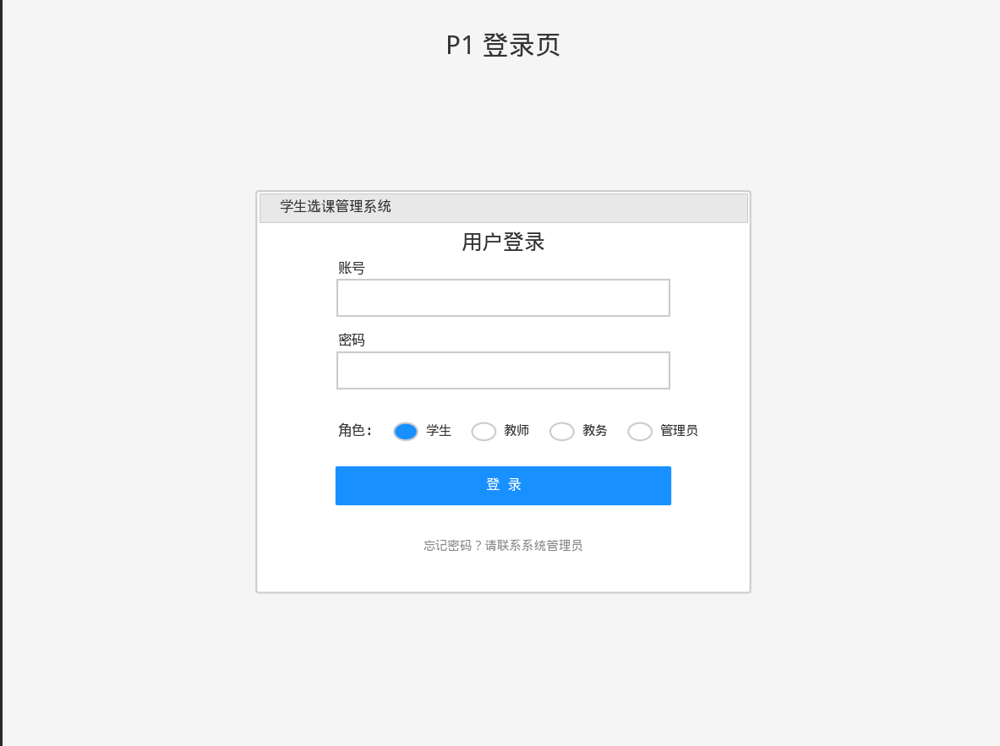
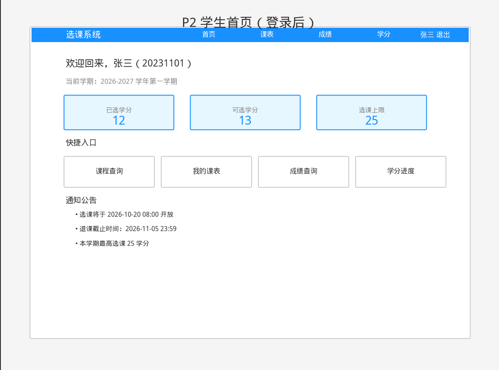
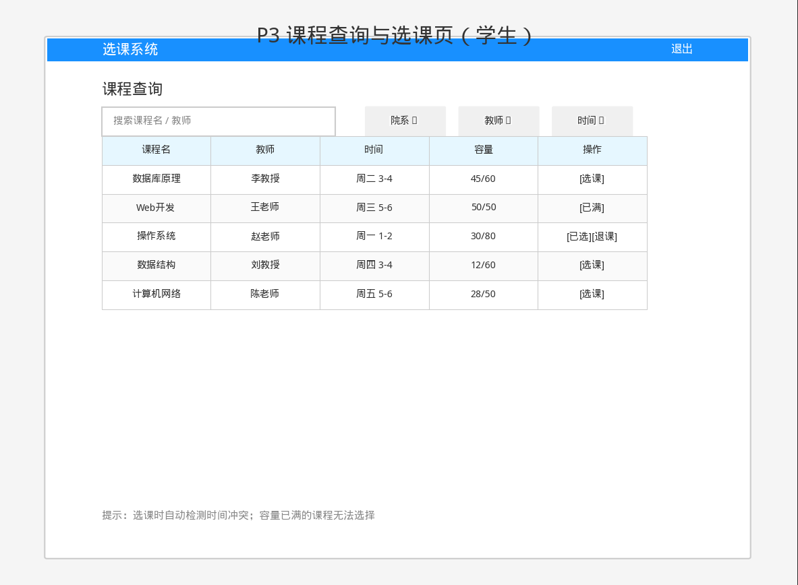
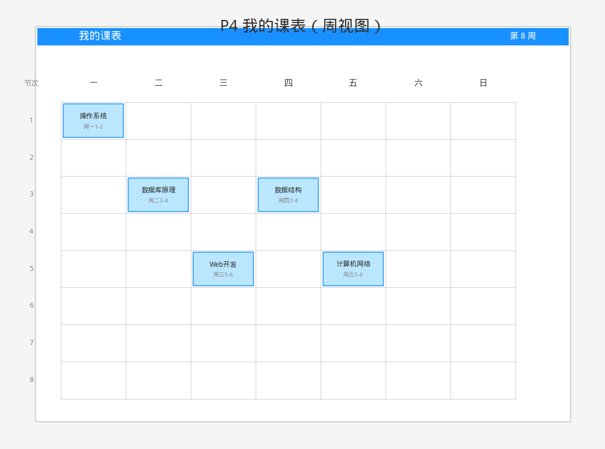
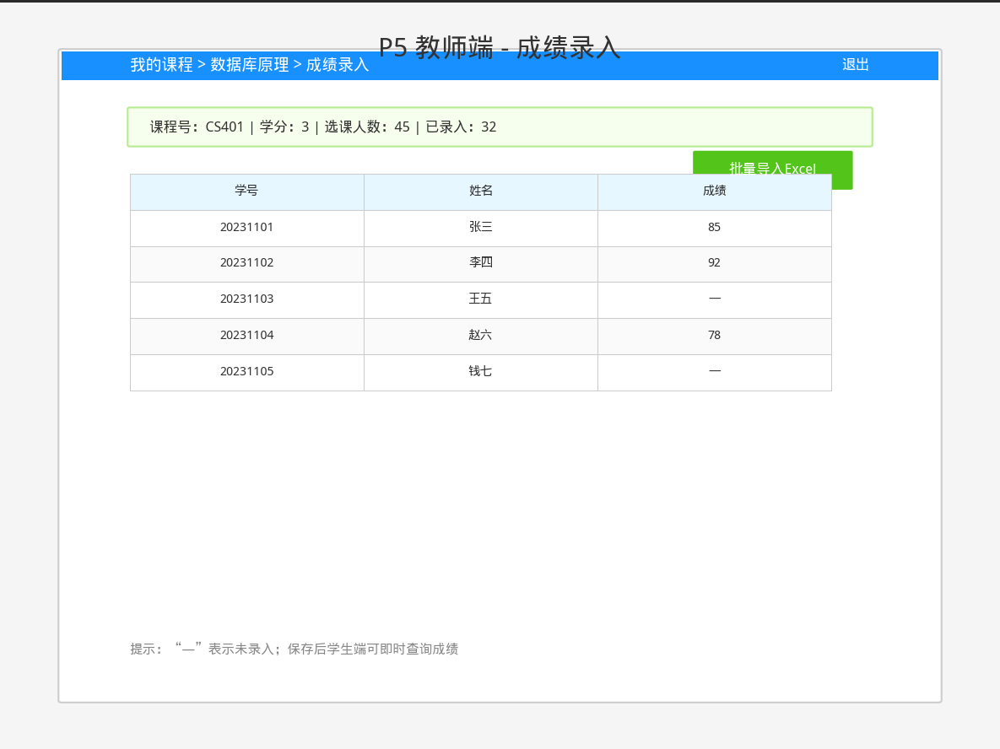
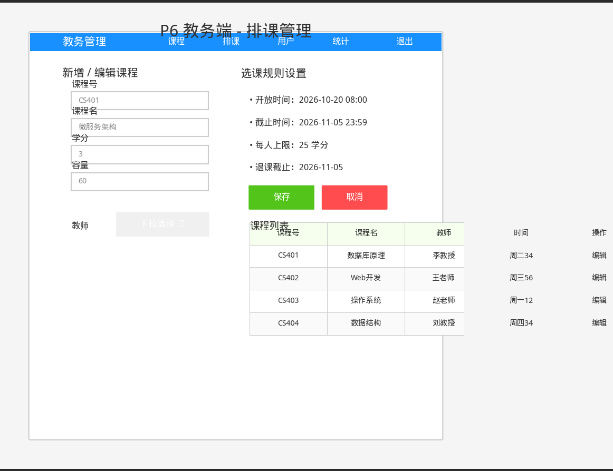

# 原型图说明

## P1 登录页
- 使用者：所有角色
- 功能：账号密码登录，选择角色
- 关键数据：账号、密码、角色类型
- 

## P2 学生首页
- 使用者：学生
- 功能：展示已选学分、快捷入口
- 关键数据：当前学期、已选学分/上限
- 

## P3 课程查询与选课
- 使用者：学生
- 功能：搜索筛选课程、选课/退课
- 关键数据：课程列表（名/教师/时间/容量/已选人数）
- 

## P4 我的课表
- 使用者：学生
- 功能：周视图展示课程安排
- 关键数据：课程名、时间格子、地点

## P5 教师成绩录入
- 使用者：教师
- 功能：查看学生名单、录入/修改成绩
- 关键数据：学生列表、成绩字段

## P6 教务排课管理
- 使用者：教务管理员
- 功能：新增/编辑课程、设置选课规则
- 关键数据：课程信息表单、选课时间规则

